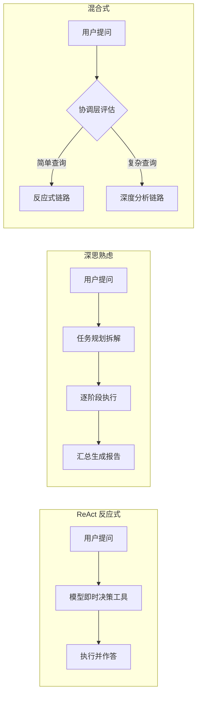

# Financial Agent Suite - 金融场景多架构 Agent 套件

面向金融场景的 Agent 三种架构模式实战项目：在同一技术栈下对比实现 ReAct 反应式、深思熟虑（Deliberative）、混合式（Hybrid）三种 Agent 架构，并配套 MCP 工具服务接入与 DeepEval 自动化效果评估，形成"构建 - 接入 - 评估"的完整闭环。

## 三种架构模式对比



| 架构模式 | 决策方式 | 适用场景 | 本项目实现 |
| --- | --- | --- | --- |
| ReAct 反应式 | 模型边想边做，即时选择工具 | 低延迟问答、检索类任务 | 私募基金问答助手（`create_agent` + `@tool`） |
| 深思熟虑 | 先规划后执行，多阶段推演 | 投研报告、多步分析任务 | 智能投研助手（LangGraph 五阶段流水线） |
| 混合式 | 协调层按查询复杂度分流 | 生产环境兼顾延迟与深度 | 投顾 AI 助手（协调层 + 双链路） |

## 目录结构

```
financial-agent-suite/
├── README.md                  # 项目说明
├── requirements.txt           # 依赖清单
├── .env.example               # 环境变量模板
├── reactive_fund_qa/          # ReAct 反应式：私募基金问答助手
├── deliberative_research/     # 深思熟虑：智能投研助手
├── hybrid_advisor/            # 混合式：投顾 AI 助手
├── mcp_tools/                 # MCP 工具服务（自研 Server + 集成示例）
└── evaluation/                # DeepEval 效果评估
```

## 模块介绍

| 模块 | 架构模式 | 说明 |
| --- | --- | --- |
| `reactive_fund_qa/fund_qa_langchain.py` | ReAct 反应式 | 私募基金运作指引问答，Agent 自主选择关键词/类别检索工具即时作答 |
| `deliberative_research/deliberative_research_langgraph.py` | 深思熟虑 | 感知 - 建模 - 推理 - 决策 - 报告五阶段流水线，多方案推演后生成投研报告 |
| `hybrid_advisor/hybrid_wealth_advisor_langgraph.py` | 混合式 | 协调层先评估查询类型，简单查询走反应式工具调用，复杂查询走深度分析链路 |
| `mcp_tools/txt_counter.py` | MCP 自研 Server | 基于 FastMCP 的桌面 txt 文件统计服务（统计/列举/读取） |
| `mcp_tools/assistant_mcp_*.py` | MCP 客户端集成 | qwen-agent Assistant 接入自研 txt_counter、高德地图、Tavily 搜索三个 MCP Server |
| `evaluation/deepeval_wealth_advisor.py` | 效果评估 | 对混合式投顾助手做答案相关性、幻觉检测、风险偏好匹配度的自动化评估 |

## 环境配置

```bash
pip install -r requirements.txt
cp .env.example .env   # 填入自己的 API Key
```

所有模型调用统一走 OpenAI 兼容协议（默认端点为通义千问兼容模式，`OPENAI_BASE_URL` 可替换为任意兼容端点）。高德/Tavily 两个 MCP Server 通过 `npx` 启动，需本机已安装 Node.js。

## 运行方式

```bash
# ReAct 反应式：私募基金问答
python reactive_fund_qa/fund_qa_langchain.py

# 深思熟虑：智能投研
python deliberative_research/deliberative_research_langgraph.py

# 混合式：投顾 AI 助手
python hybrid_advisor/hybrid_wealth_advisor_langgraph.py

# MCP：先启动自研 Server，再运行客户端（需在 mcp_tools 目录下）
cd mcp_tools
python txt_counter.py                 # 方式一：独立启动 MCP Server
python assistant_mcp_txt_bot.py       # 方式二：客户端自动拉起 Server，启动 Web 界面

# DeepEval 效果评估（在项目根目录下执行）
python evaluation/deepeval_wealth_advisor.py
```

## 技术栈

Python + LangChain 1.x（ChatOpenAI / create_agent）+ LangGraph（StateGraph 状态机编排）+ MCP（FastMCP 自研 Server、qwen-agent 客户端）+ DeepEval / LangSmith（效果评估与追踪）+ OpenAI 兼容协议（统一模型接入）。
